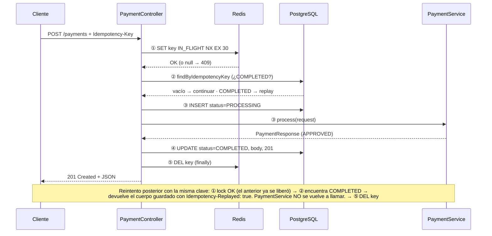
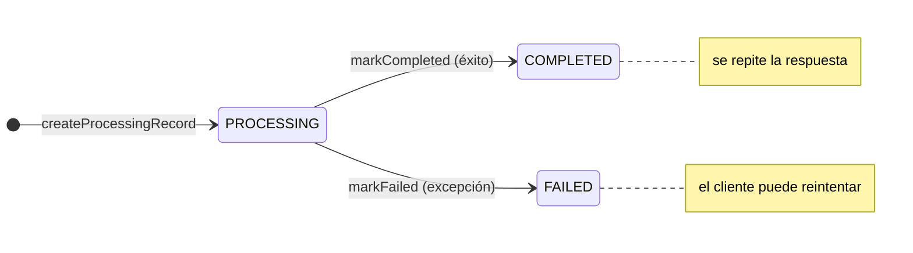

# idempotency-demo

Una API de pagos en Spring Boot 4.1 que garantiza que una misma operación no se ejecuta dos veces, combinando un **lock en Redis** (hot-path) con un **registro persistente en PostgreSQL** (cold-path).

`Java 21` · `Spring Boot 4.1.2` · `Spring Data JPA` · `Spring Data Redis (Lettuce)` · `PostgreSQL` · `Flyway` · `Testcontainers 2.0` · `Lombok`

> Versión HTML de esta documentación, con diagramas: [`docs/index.html`](docs/index.html)

## Contenido

1. [Resumen](#1-resumen)
2. [Arquitectura: hot-path y cold-path](#2-arquitectura-hot-path-y-cold-path)
3. [Flujo de una petición](#3-flujo-de-una-petición)
4. [Estructura del proyecto](#4-estructura-del-proyecto)
5. [Componentes](#5-componentes)
6. [Modelo de datos](#6-modelo-de-datos)
7. [API HTTP](#7-api-http)
8. [Configuración](#8-configuración)
9. [Tests](#9-tests)
10. [Ejecutar](#10-ejecutar)
11. [Observaciones y posibles mejoras](#11-observaciones-y-posibles-mejoras)

## 1. Resumen

En sistemas distribuidos un cliente puede reenviar una petición (timeout de red, reintento automático, doble clic). Para operaciones con efectos secundarios, como un cobro, eso produciría *dos* pagos. El patrón **Idempotency-Key** lo evita: el cliente envía una clave única por operación en la cabecera `Idempotency-Key`, y el servidor garantiza que:

- Si llegan **dos peticiones a la vez** con la misma clave, solo una se procesa; la otra recibe `409 Conflict`.
- Si llega **un reintento después** de que la primera terminó, se devuelve la respuesta original guardada, sin volver a ejecutar la lógica de negocio, con la cabecera `Idempotency-Replayed: true`.

Esto se implementa con un mecanismo *check-and-set* de dos niveles, que da nombre a los servicios del proyecto.

## 2. Arquitectura: hot-path y cold-path

| Hot-path · Redis (`IdempotencyHotPathService`) | Cold-path · PostgreSQL (`IdempotencyColdPathService`) |
|---|---|
| Protege contra **duplicados concurrentes**. Usa el comando atómico `SET key IN_FLIGHT NX EX 30`: solo el primer hilo/nodo que llega consigue crear la clave. El lock es temporal (TTL de 30 s) y se borra al terminar la petición. | Protege contra **reintentos posteriores**. Guarda de forma duradera el estado de cada clave (`PROCESSING` → `COMPLETED` / `FAILED`) junto con el código HTTP y el cuerpo JSON de la respuesta original, para poder repetirla. |

> **¿Por qué dos almacenes?**
> Redis es rápido y su `SET NX` es atómico, ideal para un lock distribuido de corta vida, pero no es la fuente de verdad duradera. PostgreSQL es duradero y transaccional, ideal para guardar el resultado final, pero sería más lento y complejo usarlo como lock bajo alta concurrencia. Cada uno cubre la debilidad del otro.

## 3. Flujo de una petición

Todo el ciclo está orquestado en `PaymentController.createPayment()`:

1. **Adquirir lock (hot-path).** `hotPath.tryAcquireLock(key)`. Si la clave ya existe en Redis, lanza `DuplicateInFlightException`, que se traduce en `409`. Esto ocurre *antes* del bloque `try`, así que el lock de otra petición nunca se libera por error.
2. **Comprobar si ya se completó (cold-path).** `coldPath.checkCompleted(key)` busca un registro con estado `COMPLETED`. Si existe, deserializa el `responseBody` guardado y lo devuelve con el código original y la cabecera `Idempotency-Replayed: true`.
3. **Ejecutar.** Crea (o reutiliza) un registro `PROCESSING` y llama a `paymentService.process(request)`.
4. **Persistir.** Serializa la respuesta a JSON y llama a `coldPath.markCompleted(key, 201, body)`. Devuelve `201 Created`.
5. **Liberar lock.** En el `finally`, `hotPath.releaseLock(key)` borra la clave de Redis, tanto si hubo éxito como error. Si hubo una excepción, antes se marca el registro como `FAILED` para que el cliente pueda reintentar.



### Ciclo de vida del registro en PostgreSQL



Solo un registro `COMPLETED` provoca un replay; `PROCESSING` y `FAILED` dejan pasar la petición a la lógica de negocio.

## 4. Estructura del proyecto

```text
src/main/java/com/vivaldispring/idempotency/
├── IdempotencyApplication.java          # Punto de entrada Spring Boot
├── config/
│   ├── IdempotencyConstants.java        # Nombre de cabecera, TTL, valor del lock
│   └── RedisConfig.java                 # Bean StringRedisTemplate
├── controller/
│   └── PaymentController.java           # POST /payments — orquesta el flujo
├── exception/
│   ├── DuplicateInFlightException.java  # Lock ya tomado
│   └── GlobalExceptionHandler.java      # → 409 ProblemDetail (RFC 9457)
├── model/
│   ├── IdempotencyRecord.java           # Entidad JPA
│   ├── IdempotencyStatus.java           # PROCESSING | COMPLETED | FAILED
│   ├── PaymentRequest.java              # record con validación
│   └── PaymentResponse.java             # record de respuesta
├── repository/
│   └── IdempotencyRecordRepository.java # Spring Data JPA + UPDATE JPQL
└── service/
    ├── IdempotencyHotPathService.java   # Lock Redis
    ├── IdempotencyColdPathService.java  # Registro PostgreSQL
    └── PaymentService.java              # Lógica de negocio (stub)

src/main/resources/
├── application.yml
└── db/migration/V1__create_idempotency_records.sql
```

## 5. Componentes

### PaymentController

`controller/PaymentController.java`

Único endpoint REST: `POST /payments`. Recibe la cabecera obligatoria `Idempotency-Key` y un `PaymentRequest` validado con `@Valid`. Depende de los dos servicios de idempotencia, de `PaymentService` y del `ObjectMapper` de Jackson 3 (`tools.jackson.databind`, el paquete nuevo en Spring Boot 4) para (de)serializar la respuesta guardada.

```java
hotPath.tryAcquireLock(idempotencyKey);          // fuera del try: si falla, no se libera nada
try {
    var existing = coldPath.checkCompleted(idempotencyKey);
    if (existing.isPresent()) { /* replay con Idempotency-Replayed: true */ }
    coldPath.createProcessingRecord(idempotencyKey);
    PaymentResponse result = paymentService.process(request);
    coldPath.markCompleted(idempotencyKey, 201, objectMapper.writeValueAsString(result));
    return ResponseEntity.status(CREATED).body(result);
} catch (Exception ex) {
    coldPath.markFailed(idempotencyKey);
    throw ex;
} finally {
    hotPath.releaseLock(idempotencyKey);
}
```

### IdempotencyHotPathService

`service/IdempotencyHotPathService.java`

| Método | Qué hace |
|---|---|
| `tryAcquireLock(key)` | `opsForValue().setIfAbsent(key, "IN_FLIGHT", 30s)`. Devuelve `true` si lo consigue; si Redis devuelve `false` o `null`, registra un warning y lanza `DuplicateInFlightException`. |
| `releaseLock(key)` | `DEL key`. Seguro aunque la clave ya no exista. |
| `isLocked(key)` | `EXISTS key`. Pensado para tests. |
| `getLockValue(key)` | `GET key` (devuelve `IN_FLIGHT` o `null`). Pensado para tests. |

El TTL de 30 s actúa como red de seguridad: si la instancia se cae a mitad de la petición y nunca llega al `finally`, el lock expira solo y la clave no queda bloqueada para siempre.

### IdempotencyColdPathService

`service/IdempotencyColdPathService.java`

| Método | Transacción | Qué hace |
|---|---|---|
| `checkCompleted(key)` | read-only | Busca por clave y filtra a `status == COMPLETED`. |
| `createProcessingRecord(key)` | sí | Si ya hay registro (p. ej. uno `FAILED` de un intento anterior) lo devuelve; si no, inserta uno nuevo en `PROCESSING` con `responseStatus = 0`. |
| `markCompleted(key, status, body)` | sí | Ejecuta un `UPDATE` JPQL masivo: estado, cuerpo, código HTTP y `completedAt`. |
| `markFailed(key)` | sí | Si existe el registro, lo pasa a `FAILED`. No-op si no existe. |

### PaymentService

`service/PaymentService.java`

Simulación de la lógica de negocio cara y con efectos secundarios (cobro en pasarela, apunte contable…). Devuelve siempre un `PaymentResponse` con un `transactionId` UUID aleatorio y estado `APPROVED`. Que el UUID sea distinto en cada ejecución es justo lo que permite a los tests comprobar que un replay devuelve la *misma* transacción y no una nueva.

### IdempotencyRecordRepository

`repository/IdempotencyRecordRepository.java`

- `findByIdempotencyKey(String)` — consulta derivada.
- `existsByIdempotencyKeyAndStatus(String, IdempotencyStatus)` — consulta derivada (actualmente solo usada en tests).
- `markCompleted(...)` — `@Modifying @Query` con un `UPDATE` JPQL; devuelve el número de filas afectadas.

### Excepciones

`exception/`

`DuplicateInFlightException` (`RuntimeException`) lleva la clave en conflicto. `GlobalExceptionHandler` (`@RestControllerAdvice`) la convierte en un `ProblemDetail` estándar RFC 9457 con estado 409, un `type` URI y la propiedad extra `idempotencyKey`.

### Configuración

`config/`

`IdempotencyConstants` centraliza `HEADER = "Idempotency-Key"`, `LOCK_TTL_SECONDS = 30` e `IN_FLIGHT_VALUE = "IN_FLIGHT"`. `RedisConfig` declara un `StringRedisTemplate` sobre la conexión Lettuce autoconfigurada.

## 6. Modelo de datos

Tabla `idempotency_records`, creada por la migración Flyway `V1__create_idempotency_records.sql` y mapeada por la entidad `IdempotencyRecord`. Hibernate arranca con `ddl-auto: validate`, así que la entidad debe coincidir con el esquema.

| Columna | Tipo | Restricciones | Significado |
|---|---|---|---|
| `id` | BIGSERIAL | PK | Identificador interno (`GenerationType.IDENTITY`). |
| `idempotency_key` | VARCHAR(255) | NOT NULL, UNIQUE | Clave enviada por el cliente. |
| `status` | VARCHAR(20) | NOT NULL | `PROCESSING` / `COMPLETED` / `FAILED` (`EnumType.STRING`). |
| `response_status` | INTEGER | NOT NULL, default 0 | Código HTTP original (0 mientras no termina). |
| `response_body` | TEXT | | JSON de la respuesta original. |
| `created_at` | TIMESTAMPTZ | NOT NULL | Se rellena en `@PrePersist`. |
| `completed_at` | TIMESTAMPTZ | | Se rellena al completar. |

La restricción `UNIQUE` sobre `idempotency_key` es la última línea de defensa: aunque fallara el lock de Redis, la base de datos no permitiría dos registros con la misma clave.

## 7. API HTTP

### `POST /payments`

```http
POST /payments HTTP/1.1
Content-Type: application/json
Idempotency-Key: 6f1c9e2a-0b7d-4c55-9a1e-3f2d8b7c4e10

{ "accountId": "ACC-001", "amount": 99.95, "currency": "EUR" }
```

Validaciones del cuerpo (`PaymentRequest`): `accountId` y `currency` `@NotBlank`; `amount` `@Positive`.

| Respuesta | Cuándo |
|---|---|
| `201` | Primera ejecución correcta. Cuerpo `PaymentResponse`. |
| `201` + `Idempotency-Replayed: true` | Reintento de una clave ya `COMPLETED`: mismo cuerpo que la primera vez. |
| `409` | Otra petición con la misma clave está en curso. Cuerpo `ProblemDetail`. |
| `400` | Falta la cabecera `Idempotency-Key` o el cuerpo no pasa la validación. |

```jsonc
// 201
{ "transactionId": "1b4e…", "accountId": "ACC-001", "amount": 99.95,
  "currency": "EUR", "status": "APPROVED", "processedAt": "2026-11-10T09:12:44Z" }

// 409 (application/problem+json)
{ "type": "https://example.com/errors/duplicate-in-flight", "title": "Conflict", "status": 409,
  "detail": "A request with this idempotency key is already being processed",
  "instance": "/payments", "idempotencyKey": "6f1c9e2a-…" }
```

Actuator expone además `/actuator/health` (con detalles), `/actuator/info` y `/actuator/metrics`.

## 8. Configuración

`src/main/resources/application.yml`

| Ámbito | Valores relevantes |
|---|---|
| Datasource | PostgreSQL en `192.168.1.10:5432/idempotency`, pool Hikari de 10 conexiones. |
| JPA | `ddl-auto: validate`, dialecto PostgreSQL. |
| Redis | `localhost:6379`, timeout 2 s, pool Lettuce (8 activas / 4 inactivas). |
| Flyway | Habilitado, `classpath:db/migration`. |
| Logging | `DEBUG` para `com.vivaldispring.idempotency`. |

## 9. Tests

La batería cubre cada capa por separado y luego el sistema completo con contenedores reales.

| Clase | Tipo | Qué verifica |
|---|---|---|
| `IdempotencyHotPathServiceTest` | Unitario (Mockito) | Lock adquirido / duplicado → excepción, TTL de 30 s, valor `IN_FLIGHT`, `null` de Redis tratado como fallo, liberación idempotente, introspección. |
| `IdempotencyColdPathServiceTest` | Unitario (Mockito) | `checkCompleted` solo acepta `COMPLETED`; `createProcessingRecord` reutiliza registros; `markCompleted` / `markFailed`. |
| `IdempotencyRecordRepositoryTest` | `@DataJpaTest` + PostgreSQL real | Ida y vuelta de guardado, `UPDATE` de `markCompleted`, consultas derivadas, restricción `UNIQUE`. |
| `PaymentIdempotencyIntegrationTest` | `@SpringBootTest` + PostgreSQL + Redis reales | Happy path, replay con mismo `transactionId` y cabecera, que el replay no crea filas nuevas, concurrencia (2 y 5 hilos: solo uno obtiene 201), cuerpo `ProblemDetail` del 409, errores 400, claves independientes. |

`ContainersBase` arranca un único `postgres:16-alpine` y un `redis:7-alpine` estáticos compartidos entre clases y sobrescribe las propiedades de conexión con `@DynamicPropertySource`. JaCoCo genera el informe de cobertura en la fase `test`.

## 10. Ejecutar

```bash
# Tests (requiere Docker para Testcontainers)
./mvnw test        # o: mvn test
# Informe de cobertura: target/site/jacoco/index.html

# Arrancar la aplicación (requiere PostgreSQL y Redis accesibles según application.yml)
mvn spring-boot:run

# Probar la idempotencia
KEY=$(uuidgen)
curl -i -X POST localhost:8080/payments \
  -H "Content-Type: application/json" -H "Idempotency-Key: $KEY" \
  -d '{"accountId":"ACC-001","amount":10,"currency":"EUR"}'
# Repite el mismo comando: misma transactionId + "Idempotency-Replayed: true"
```

## 11. Observaciones y posibles mejoras

Puntos detectados al revisar el código, útiles si el proyecto evoluciona más allá de demo:

> [!WARNING]
> **Flyway sin dependencia.** El `pom.xml` no incluye `spring-boot-starter-flyway` (ni `flyway-core` / `flyway-database-postgresql`). En Spring Boot 4 la autoconfiguración de Flyway es un módulo aparte, así que las propiedades `spring.flyway.*` no tienen efecto y la tabla debe existir previamente para que pase `ddl-auto: validate`.

- **Expiración del lock durante el proceso.** Si `PaymentService` tarda más de 30 s, el lock caduca y otra petición con la misma clave podría ejecutarse en paralelo (encontraría un registro `PROCESSING`, que no bloquea). Se podría tratar `PROCESSING` como 409 en el cold-path, o renovar el TTL.
- **Liberación del lock sin comprobar propietario.** `releaseLock` hace `DEL` sin verificar que el lock sigue siendo suyo; tras una expiración podría borrar el lock de otra petición. Lo habitual es guardar un token único y borrar con un script Lua *compare-and-delete*.
- **No se compara el payload.** Una misma clave con un cuerpo distinto devuelve la respuesta original. Guardar un hash del request y responder 422 si no coincide es una práctica común.
- **Sin espacio de nombres en Redis.** La clave del lock es directamente el `Idempotency-Key`; un prefijo (`idem:payments:`) evita colisiones con otros usos de Redis.
- **Sin limpieza de registros.** Los registros de PostgreSQL no caducan; normalmente se purgan tras 24 h–7 días.
- **Índice redundante.** La restricción `UNIQUE` ya crea un índice, por lo que `idx_idempotency_key` lo duplica.
- **Transacciones separadas.** `createProcessingRecord`, la lógica de negocio y `markCompleted` ocurren en transacciones distintas; si el proceso muere entre medias, el registro queda en `PROCESSING`. Con un pago real conviene que el resultado de negocio y el `COMPLETED` se confirmen juntos (o usar un patrón outbox).
