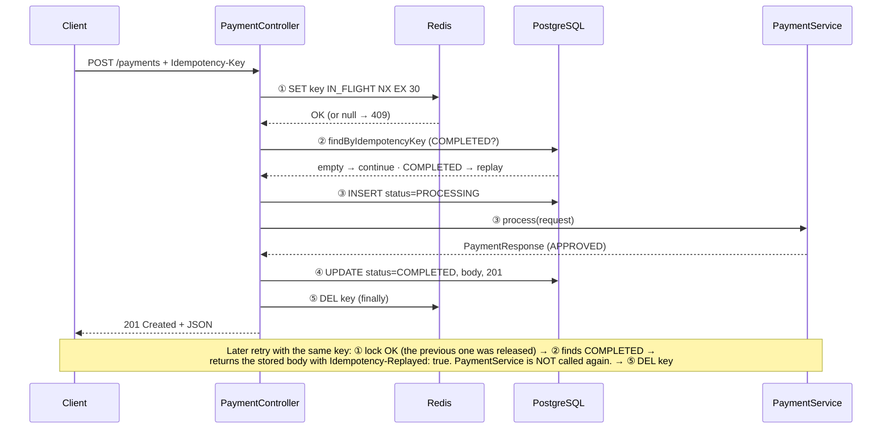
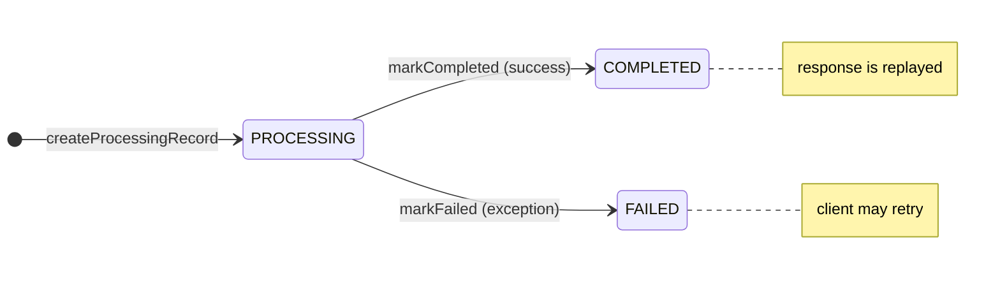

# idempotency-demo

A Spring Boot 4.1 payments API that guarantees the same operation is never executed twice, combining a **Redis lock** (hot-path) with a **persistent record in PostgreSQL** (cold-path).

`Java 21` · `Spring Boot 4.1.2` · `Spring Data JPA` · `Spring Data Redis (Lettuce)` · `PostgreSQL` · `Flyway` · `Testcontainers 2.0` · `Lombok`

> HTML version of this documentation, with diagrams: [English](docs/index.en.html) · [Español](docs/index.html)

## Contents

1. [Overview](#1-overview)
2. [Architecture: hot-path and cold-path](#2-architecture-hot-path-and-cold-path)
3. [Request flow](#3-request-flow)
4. [Project structure](#4-project-structure)
5. [Components](#5-components)
6. [Data model](#6-data-model)
7. [HTTP API](#7-http-api)
8. [Configuration](#8-configuration)
9. [Tests](#9-tests)
10. [Running](#10-running)
11. [Notes and possible improvements](#11-notes-and-possible-improvements)

## 1. Overview

In distributed systems a client may resend a request (network timeout, automatic retry, double click). For operations with side effects, such as a charge, that would produce *two* payments. The **Idempotency-Key** pattern prevents this: the client sends a unique key per operation in the `Idempotency-Key` header, and the server guarantees that:

- If **two requests arrive at the same time** with the same key, only one is processed; the other gets `409 Conflict`.
- If **a retry arrives later**, after the first one has finished, the stored original response is returned without running the business logic again, with the header `Idempotency-Replayed: true`.

This is implemented with a two-level *check-and-set* mechanism, which gives the project's services their names.

## 2. Architecture: hot-path and cold-path

| Hot-path · Redis (`IdempotencyHotPathService`) | Cold-path · PostgreSQL (`IdempotencyColdPathService`) |
|---|---|
| Protects against **concurrent duplicates**. Uses the atomic command `SET key IN_FLIGHT NX EX 30`: only the first thread/node to arrive manages to create the key. The lock is temporary (30 s TTL) and is deleted when the request finishes. | Protects against **later retries**. Durably stores the state of each key (`PROCESSING` → `COMPLETED` / `FAILED`) together with the HTTP status code and the JSON body of the original response, so it can be replayed. |

> **Why two stores?**
> Redis is fast and its `SET NX` is atomic, ideal for a short-lived distributed lock, but it is not the durable source of truth. PostgreSQL is durable and transactional, ideal for storing the final result, but using it as a lock under high concurrency would be slower and more complex. Each one covers the other's weakness.

## 3. Request flow

The whole cycle is orchestrated in `PaymentController.createPayment()`:

1. **Acquire the lock (hot-path).** `hotPath.tryAcquireLock(key)`. If the key already exists in Redis, it throws `DuplicateInFlightException`, which is mapped to `409`. This happens *before* the `try` block, so another request's lock is never released by mistake.
2. **Check whether it already completed (cold-path).** `coldPath.checkCompleted(key)` looks for a record with status `COMPLETED`. If one exists, it deserializes the stored `responseBody` and returns it with the original status code and the header `Idempotency-Replayed: true`.
3. **Execute.** Creates (or reuses) a `PROCESSING` record and calls `paymentService.process(request)`.
4. **Persist.** Serializes the response to JSON and calls `coldPath.markCompleted(key, 201, body)`. Returns `201 Created`.
5. **Release the lock.** In the `finally` block, `hotPath.releaseLock(key)` deletes the key from Redis, on both success and failure. If an exception occurred, the record is first marked as `FAILED` so the client can retry.



### Lifecycle of the PostgreSQL record



Only a `COMPLETED` record triggers a replay; `PROCESSING` and `FAILED` let the request through to the business logic.

## 4. Project structure

```text
src/main/java/com/vivaldispring/idempotency/
├── IdempotencyApplication.java          # Spring Boot entry point
├── config/
│   ├── IdempotencyConstants.java        # Header name, TTL, lock value
│   └── RedisConfig.java                 # StringRedisTemplate bean
├── controller/
│   └── PaymentController.java           # POST /payments — orchestrates the flow
├── exception/
│   ├── DuplicateInFlightException.java  # Lock already taken
│   └── GlobalExceptionHandler.java      # → 409 ProblemDetail (RFC 9457)
├── model/
│   ├── IdempotencyRecord.java           # JPA entity
│   ├── IdempotencyStatus.java           # PROCESSING | COMPLETED | FAILED
│   ├── PaymentRequest.java              # record with validation
│   └── PaymentResponse.java             # response record
├── repository/
│   └── IdempotencyRecordRepository.java # Spring Data JPA + JPQL UPDATE
└── service/
    ├── IdempotencyHotPathService.java   # Redis lock
    ├── IdempotencyColdPathService.java  # PostgreSQL record
    └── PaymentService.java              # Business logic (stub)

src/main/resources/
├── application.yml
└── db/migration/V1__create_idempotency_records.sql
```

## 5. Components

### PaymentController

`controller/PaymentController.java`

The only REST endpoint: `POST /payments`. It takes the mandatory `Idempotency-Key` header and a `PaymentRequest` validated with `@Valid`. It depends on the two idempotency services, on `PaymentService`, and on the Jackson 3 `ObjectMapper` (`tools.jackson.databind`, the new package in Spring Boot 4) to (de)serialize the stored response.

```java
hotPath.tryAcquireLock(idempotencyKey);          // outside the try: if it fails, nothing is released
try {
    var existing = coldPath.checkCompleted(idempotencyKey);
    if (existing.isPresent()) { /* replay with Idempotency-Replayed: true */ }
    coldPath.createProcessingRecord(idempotencyKey);
    PaymentResponse result = paymentService.process(request);
    coldPath.markCompleted(idempotencyKey, 201, objectMapper.writeValueAsString(result));
    return ResponseEntity.status(CREATED).body(result);
} catch (Exception ex) {
    coldPath.markFailed(idempotencyKey);
    throw ex;
} finally {
    hotPath.releaseLock(idempotencyKey);
}
```

### IdempotencyHotPathService

`service/IdempotencyHotPathService.java`

| Method | What it does |
|---|---|
| `tryAcquireLock(key)` | `opsForValue().setIfAbsent(key, "IN_FLIGHT", 30s)`. Returns `true` on success; if Redis returns `false` or `null`, it logs a warning and throws `DuplicateInFlightException`. |
| `releaseLock(key)` | `DEL key`. Safe even if the key no longer exists. |
| `isLocked(key)` | `EXISTS key`. Intended for tests. |
| `getLockValue(key)` | `GET key` (returns `IN_FLIGHT` or `null`). Intended for tests. |

The 30 s TTL acts as a safety net: if the instance dies mid-request and never reaches the `finally` block, the lock expires on its own and the key is not blocked forever.

### IdempotencyColdPathService

`service/IdempotencyColdPathService.java`

| Method | Transaction | What it does |
|---|---|---|
| `checkCompleted(key)` | read-only | Looks up by key and filters to `status == COMPLETED`. |
| `createProcessingRecord(key)` | yes | If a record already exists (e.g. a `FAILED` one from a previous attempt) it returns it; otherwise it inserts a new one in `PROCESSING` with `responseStatus = 0`. |
| `markCompleted(key, status, body)` | yes | Runs a bulk JPQL `UPDATE`: status, body, HTTP code and `completedAt`. |
| `markFailed(key)` | yes | If the record exists, sets it to `FAILED`. No-op if it does not exist. |

### PaymentService

`service/PaymentService.java`

A simulation of expensive business logic with side effects (gateway charge, ledger entry…). It always returns a `PaymentResponse` with a random UUID `transactionId` and status `APPROVED`. The UUID being different on every execution is exactly what lets the tests verify that a replay returns the *same* transaction rather than a new one.

### IdempotencyRecordRepository

`repository/IdempotencyRecordRepository.java`

- `findByIdempotencyKey(String)` — derived query.
- `existsByIdempotencyKeyAndStatus(String, IdempotencyStatus)` — derived query (currently only used in tests).
- `markCompleted(...)` — `@Modifying @Query` with a JPQL `UPDATE`; returns the number of affected rows.

### Exceptions

`exception/`

`DuplicateInFlightException` (`RuntimeException`) carries the conflicting key. `GlobalExceptionHandler` (`@RestControllerAdvice`) turns it into a standard RFC 9457 `ProblemDetail` with status 409, a `type` URI and the extra property `idempotencyKey`.

### Configuration classes

`config/`

`IdempotencyConstants` centralizes `HEADER = "Idempotency-Key"`, `LOCK_TTL_SECONDS = 30` and `IN_FLIGHT_VALUE = "IN_FLIGHT"`. `RedisConfig` declares a `StringRedisTemplate` on top of the auto-configured Lettuce connection.

## 6. Data model

Table `idempotency_records`, created by the Flyway migration `V1__create_idempotency_records.sql` and mapped by the `IdempotencyRecord` entity. Hibernate starts with `ddl-auto: validate`, so the entity must match the schema.

| Column | Type | Constraints | Meaning |
|---|---|---|---|
| `id` | BIGSERIAL | PK | Internal identifier (`GenerationType.IDENTITY`). |
| `idempotency_key` | VARCHAR(255) | NOT NULL, UNIQUE | Key sent by the client. |
| `status` | VARCHAR(20) | NOT NULL | `PROCESSING` / `COMPLETED` / `FAILED` (`EnumType.STRING`). |
| `response_status` | INTEGER | NOT NULL, default 0 | Original HTTP code (0 until finished). |
| `response_body` | TEXT | | JSON of the original response. |
| `created_at` | TIMESTAMPTZ | NOT NULL | Set in `@PrePersist`. |
| `completed_at` | TIMESTAMPTZ | | Set on completion. |

The `UNIQUE` constraint on `idempotency_key` is the last line of defense: even if the Redis lock failed, the database would not allow two records with the same key.

## 7. HTTP API

### `POST /payments`

```http
POST /payments HTTP/1.1
Content-Type: application/json
Idempotency-Key: 6f1c9e2a-0b7d-4c55-9a1e-3f2d8b7c4e10

{ "accountId": "ACC-001", "amount": 99.95, "currency": "EUR" }
```

Body validation (`PaymentRequest`): `accountId` and `currency` are `@NotBlank`; `amount` is `@Positive`.

| Response | When |
|---|---|
| `201` | First successful execution. Body is a `PaymentResponse`. |
| `201` + `Idempotency-Replayed: true` | Retry of a key that is already `COMPLETED`: same body as the first time. |
| `409` | Another request with the same key is in progress. Body is a `ProblemDetail`. |
| `400` | The `Idempotency-Key` header is missing or the body fails validation. |

```jsonc
// 201
{ "transactionId": "1b4e…", "accountId": "ACC-001", "amount": 99.95,
  "currency": "EUR", "status": "APPROVED", "processedAt": "2026-11-10T09:12:44Z" }

// 409 (application/problem+json)
{ "type": "https://example.com/errors/duplicate-in-flight", "title": "Conflict", "status": 409,
  "detail": "A request with this idempotency key is already being processed",
  "instance": "/payments", "idempotencyKey": "6f1c9e2a-…" }
```

Actuator also exposes `/actuator/health` (with details), `/actuator/info` and `/actuator/metrics`.

## 8. Configuration

`src/main/resources/application.yml`

| Area | Relevant values |
|---|---|
| Datasource | PostgreSQL at `192.168.1.10:5432/idempotency`, Hikari pool of 10 connections. |
| JPA | `ddl-auto: validate`, PostgreSQL dialect. |
| Redis | `localhost:6379`, 2 s timeout, Lettuce pool (8 active / 4 idle). |
| Flyway | Enabled, `classpath:db/migration`. |
| Logging | `DEBUG` for `com.vivaldispring.idempotency`. |

## 9. Tests

The suite covers each layer on its own and then the whole system with real containers.

| Class | Type | What it verifies |
|---|---|---|
| `IdempotencyHotPathServiceTest` | Unit (Mockito) | Lock acquired / duplicate → exception, 30 s TTL, `IN_FLIGHT` value, `null` from Redis treated as failure, idempotent release, introspection. |
| `IdempotencyColdPathServiceTest` | Unit (Mockito) | `checkCompleted` only accepts `COMPLETED`; `createProcessingRecord` reuses records; `markCompleted` / `markFailed`. |
| `IdempotencyRecordRepositoryTest` | `@DataJpaTest` + real PostgreSQL | Save round-trip, `markCompleted` `UPDATE`, derived queries, `UNIQUE` constraint. |
| `PaymentIdempotencyIntegrationTest` | `@SpringBootTest` + real PostgreSQL + Redis | Happy path, replay with the same `transactionId` and header, replay creates no new rows, concurrency (2 and 5 threads: only one gets 201), 409 `ProblemDetail` body, 400 errors, independent keys. |

`ContainersBase` starts a single static `postgres:16-alpine` and `redis:7-alpine` shared across test classes and overrides the connection properties with `@DynamicPropertySource`. JaCoCo generates the coverage report in the `test` phase.

## 10. Running

```bash
# Tests (Docker required for Testcontainers)
./mvnw test        # or: mvn test
# Coverage report: target/site/jacoco/index.html

# Start the application (PostgreSQL and Redis must be reachable as configured in application.yml)
mvn spring-boot:run

# Try out idempotency
KEY=$(uuidgen)
curl -i -X POST localhost:8080/payments \
  -H "Content-Type: application/json" -H "Idempotency-Key: $KEY" \
  -d '{"accountId":"ACC-001","amount":10,"currency":"EUR"}'
# Run the same command again: same transactionId + "Idempotency-Replayed: true"
```

## 11. Notes and possible improvements

Issues found while reviewing the code, useful if the project grows beyond a demo:

- **Lock expiry during processing.** If `PaymentService` takes longer than 30 s, the lock expires and another request with the same key could run in parallel (it would find a `PROCESSING` record, which does not block). `PROCESSING` could be treated as 409 in the cold-path, or the TTL could be renewed.
- **Lock released without checking ownership.** `releaseLock` runs `DEL` without verifying the lock still belongs to it; after an expiry it could delete another request's lock. The usual approach is to store a unique token and delete with a *compare-and-delete* Lua script.
- **Payload is not compared.** The same key with a different body returns the original response. Storing a hash of the request and responding 422 on mismatch is common practice.
- **No Redis namespace.** The lock key is the raw `Idempotency-Key`; a prefix (`idem:payments:`) avoids collisions with other uses of Redis.
- **No record cleanup.** PostgreSQL records never expire; they are usually purged after 24 h–7 days.
- **Redundant index.** The `UNIQUE` constraint already creates an index, so `idx_idempotency_key` duplicates it.
- **Separate transactions.** `createProcessingRecord`, the business logic and `markCompleted` run in different transactions; if the process dies in between, the record stays in `PROCESSING`. For a real payment, the business result and `COMPLETED` should be committed together (or use an outbox pattern).
